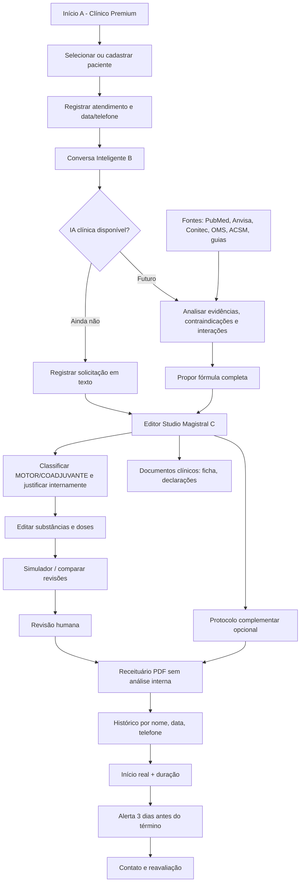

# LifeMag IA — Fluxograma funcional (protótipo + módulos planejados)

**Legenda de status:** Home, cadastro, conversa de texto, editor, simulação básica, documentos demonstrativos e cálculo interno de alerta estão programados. IA científica, notificações externas, banco seguro, atualização automática e assinatura são módulos **planejados**.
